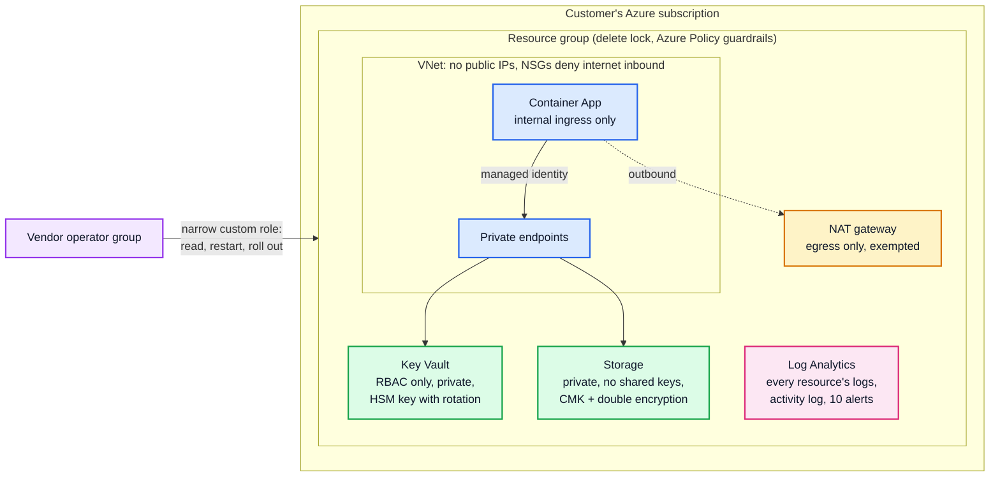

# TenantGuard

**A hardened Terraform baseline for deploying a product into a customer's Azure subscription.**

When a vendor deploys into a customer's cloud account, the customer's security team asks the same questions every time: is anything public, who can get in, where do the keys live, is it logged, and what stops it drifting next month? TenantGuard answers all five in code. Every answer is enforced three ways: Checkov in CI, Terraform tests that fail if a control is weakened, and Azure Policy in the customer's subscription after deployment.

[](https://github.com/deenojo/TenantGuard/actions/workflows/ci.yml)

Companion projects: **[Patchwarden](https://github.com/deenojo/Vulnerability-Remediation-Agent)** (self-healing vulnerability remediation) and **[PromptWall](https://github.com/deenojo/PromptWall)** (LLM runtime security gateway).

## Results

| Check | Result |
| --- | --- |
| Checkov (policy-as-code) | **54 passed, 0 failed** across 33 distinct checks; 3 skipped, each with a written reason in the code |
| Security tests (`terraform test`, mock provider, no Azure account) | **9 / 9 pass**: nothing public, no shared secrets, least privilege, everything logged, policy guardrails, audit-only rollout, and 3 input-validation tests |
| Azure Policy guardrails | **6 custom deny policies** (7 assignments) + the built-in **CIS Microsoft Azure Foundations Benchmark** initiative in audit mode |
| Logging | **11 diagnostic settings** (every resource), subscription activity log export, **10 activity-log alerts** on security-relevant changes |
| `terraform validate`, `fmt`, TFLint | Clean on the module and the example, on every push |

## Architecture



## What the baseline enforces

| Question | Answer in code | Enforced by |
| --- | --- | --- |
| **Is anything public?** | Container App has internal ingress only; Key Vault and storage have public network access off and are reached through private endpoints; NSGs explicitly deny internet inbound; the only public IP is the NAT gateway's outbound-only egress IP, which carries an explicit, documented policy exemption | Checkov, tests, `deny-public-ip`, `deny-internet-inbound-nsg-rules`, `deny-public-storage`, `deny-weak-key-vault` policies |
| **Who can get in?** | Managed identities only. The workload identity gets *Key Vault Secrets User* on one vault and *Storage Blob Data Contributor* on one container. The vendor gets a custom role, scoped to this resource group, that can read, restart and roll out the app but can't change role assignments, networking, the vault, or read storage keys | Tests (`least_privilege`), Checkov CKV_AZURE_39 |
| **Where are the keys?** | No access keys exist: shared-key auth is off on storage. Encryption uses an HSM-backed customer-managed key (RSA-HSM 3072) with automatic rotation, plus infrastructure (double) encryption. Key Vault is RBAC-only with purge protection | Checkov, tests, `deny-public-storage`, `deny-weak-key-vault` |
| **Is it logged?** | Every resource sends logs and metrics to one Log Analytics workspace (90-730 days, default 365). VNet flow logs with traffic analytics. The subscription activity log is exported. Changes to policy assignments, role assignments, NSGs, the vault or public IPs email the security contact | Tests (`everything_is_logged_and_alerted`), Checkov CKV_AZURE_12 |
| **What stops drift?** | Azure Policy denies non-compliant changes after deployment, even ones made by hand in the portal. Allowed regions and required tags are enforced too. A delete lock protects the resource group | Tests (`policy_guardrails`), the policies themselves |

The full control-by-control map, including how each one lines up with the CIS Azure Foundations Benchmark sections, is in **[CONTROLS.md](CONTROLS.md)**.

## Rolling out in a customer's subscription

Customer subscriptions are rarely empty. Set `policy_enforcement = false` first: every custom policy is assigned in **audit** mode (`DoNotEnforce`), so the customer sees what would be denied without anything breaking. Review compliance in Azure Policy, fix or exempt what's found, then switch to `true`. The `audit_only_rollout` test checks that this switch really turns enforcement off for every assignment.

## Quick start

```bash
cd examples/customer-deployment
cp terraform.tfvars.example terraform.tfvars   # the customer's subscription, regions and security contact
terraform init
terraform plan
```

Run the security tests without an Azure account:

```bash
terraform -chdir=modules/baseline init -backend=false
terraform -chdir=modules/baseline test
checkov -d . --framework terraform --compact
```

**Applying for real:** the Key Vault is private, so the deploying principal can only create the encryption key from inside the network. Apply from a runner with private access to the VNet (for example a self-hosted runner in a peered network). The deployer needs *Owner* (or *Contributor* + *Resource Policy Contributor* + *User Access Administrator*) on the subscription, because the module creates policy definitions and role assignments.

## Repo layout

```
TenantGuard/
├── modules/baseline/
│   ├── network.tf       # VNet, subnets, NSGs, private endpoints + DNS, NAT egress, flow logs
│   ├── identity.tf      # managed identities, scoped role assignments, vendor operator role
│   ├── keyvault.tf      # RBAC-only private vault, HSM CMK with rotation
│   ├── storage.tf       # private, keyless, CMK-encrypted storage
│   ├── logging.tf       # workspace, diagnostics on every resource, activity log, alerts
│   ├── policy.tf        # custom deny policies, CIS initiative, NAT exemption
│   ├── app.tf           # internal-only Container App
│   └── tests/           # terraform test suite (mock provider)
├── examples/customer-deployment/
├── CONTROLS.md
└── .github/workflows/ci.yml   # fmt, validate, test, TFLint, Checkov
```

## Limitations

- **Never applied to a real subscription.** CI validates, tests against a mock provider and runs Checkov; it never deploys, because that costs money. The mock provider checks the configuration, not Azure's runtime behavior.
- **The CIS initiative is looked up by display name** (`CIS Microsoft Azure Foundations Benchmark v2.0.0` by default). If the customer's tenant has a newer version, set `cis_initiative_display_name`.
- **Single region**, no disaster-recovery pairing. Storage is geo-zone-redundant (GZRS), but the app and vault live in one region.
- **Microsoft Defender for Cloud plans** are left to the customer: they change the subscription's billing.
